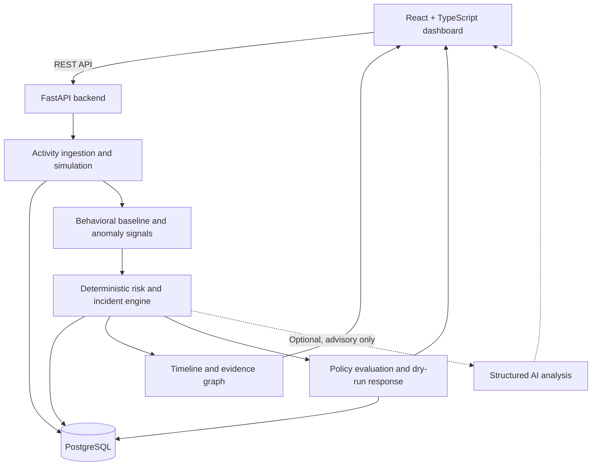

# TraceLoom

### Behavioral Security Intelligence — from activity telemetry to explainable incidents

[**Live Demo**](https://traceloom-nine.vercel.app/overview) · [**Source Code**](https://github.com/ammaraamindotcom/traceloom)

TraceLoom is a full-stack security intelligence prototype that turns simulated user activity into **behavioral baselines, anomaly signals, risk assessments, and evidence-backed incidents**. It is designed to explore a practical question: *How can a security analyst distinguish unusual behavior from routine activity—and understand why a system flagged it?*

Instead of returning an opaque risk score, TraceLoom links detections to a chronological timeline and evidence graph. A guided demo lets anyone investigate a synthetic data-exfiltration scenario end to end.

> **Scope:** TraceLoom is a research/portfolio prototype built around **synthetic telemetry**, not a production security product or a validated real-world threat detector. It does not monitor actual employees or enterprise environments.

## Try the live demo

**[Launch TraceLoom →](https://traceloom-nine.vercel.app/overview)**

1. Open the **Guided Demo** in the dashboard.
2. Generate baseline activity representing a normal workday.
3. Run the **Possible Data Exfiltration** simulation.
4. Observe the deterministic behavioral signals and **HIGH** risk assessment.
5. Open the resulting incident to explore its timeline, evidence graph, and supporting activity.
6. Explore policy decisions and dry-run response records without taking real enforcement actions.

The public deployment intentionally disables paid AI inference. Core anomaly detection, risk scoring, incident creation, and investigation work without an LLM.

## Features

| Capability | What it does |
| --- | --- |
| **Synthetic activity simulator** | Generates repeatable normal-workday, high-volume access, possible exfiltration, and credential-change scenarios. |
| **Behavioral baselines** | Establishes expected activity patterns for simulated users and compares subsequent activity against them. |
| **Deterministic anomaly detection** | Identifies signals such as high download volume, large data volume, archive creation after downloads, external upload after downloads, unusual sequences, and off-pattern activity. |
| **Risk assessment and incidents** | Converts detected signals into explainable risk assessments and persisted incident records. |
| **Evidence-driven investigation** | Presents chronological activity, contributing signals, and an evidence graph for each incident. |
| **Policy and response** | Evaluates deterministic policies and records auditable **dry-run** response decisions. |
| **Optional AI analysis** | Can generate structured advisory interpretations of intent, evidence, and uncertainty; AI does **not** decide incidents or execute responses. |
| **Scenario evaluation** | Runs a fixed synthetic test suite and reports detection and policy outcomes. |
| **Guided demo** | Walks visitors through the complete investigation workflow. |

## Architecture



**Frontend:** React, TypeScript, Vite  
**Backend:** Python, FastAPI, SQLAlchemy  
**Database:** PostgreSQL  
**Infrastructure:** Vercel (frontend), Render (API), Neon (managed PostgreSQL)  
**Testing:** Backend automated tests and frontend production build

### Detection philosophy

TraceLoom separates **observations**, **interpretation**, and **action**:

1. **Observations:** Persist simulated user events and establish a behavioral history.
2. **Interpretation:** Derive reproducible anomaly signals and deterministic risk scores, then create evidence-linked incidents.
3. **Action:** Evaluate policies and record dry-run responses. Optional LLM output provides analyst-facing context, not authoritative decisions.

This separation makes individual decisions easier to inspect, reproduce, and test.

## Evaluation

The built-in evaluation harness uses **20 fixed synthetic scenarios**.

| Metric | Result |
| --- | ---: |
| Scenarios | 20 |
| Incident detection: true positives | 4 |
| Incident detection: true negatives | 16 |
| Incident detection: false positives | 0 |
| Incident detection: false negatives | 0 |
| Incident detection accuracy | **100% on this fixed synthetic set** |
| Policy decision accuracy | **85% on this fixed synthetic set** |
| Scenario-level pass/fail | 12 passed / 8 failed |

These figures describe performance **only on the bundled scenarios**. The dataset is small, synthetic, and not representative of real organizations or adversarial behavior. The evaluation is intended to expose correctness and limitations, not establish production detection efficacy.

The deployment-preparation test run also passed **51 backend tests**, and the frontend production build succeeded. Test counts may change as the project evolves.

## Repository overview

```text
traceloom/
├── backend/              # FastAPI API, persistence, detection and tests
├── frontend/             # React + TypeScript dashboard
├── render.yaml           # Render deployment configuration
├── DEPLOYMENT.md         # Hosting and environment setup
└── README.md
```

## Running locally

**Prerequisites:** Python 3.11, Node.js/npm, Docker with Compose.

The backend uses PostgreSQL. Start the project's database service, configure backend environment variables using the provided example, then run the API:

```bash
# From the repository root
# Start the database service defined in the project Compose file
docker compose up -d postgres

cd backend
python3.11 -m venv .venv
source .venv/bin/activate
pip install -r requirements.txt

# Create your local .env using backend/.env.example
# Set DATABASE_URL to your local PostgreSQL connection string.
uvicorn app.main:app --reload
```

In another terminal:

```bash
cd frontend
npm install
npm run dev
```

Open the local Vite URL printed in the terminal (typically `http://localhost:5173`). Configure the frontend API base URL to point at your local FastAPI server. If the Compose file is not at the repository root in your checkout, run the Docker command from the directory containing it.

For production configuration, environment variables, and hosting details, see [DEPLOYMENT.md](DEPLOYMENT.md). **Never commit `.env` files, database passwords, or API keys.**

## Deployment and safety notes

- The live dashboard is hosted on **Vercel**, the API on **Render**, and PostgreSQL on **Neon**.
- The public demo uses **synthetic identities and events**; no real employee telemetry is required.
- The OpenAI-powered advisory path is **disabled on the public frontend**. Production access to paid inference is protected separately on the server.
- Policy responses are **dry runs**: the prototype does not block accounts, revoke credentials, or make changes to external systems.
- API write operations have basic rate limits, but the public prototype is **not hardened for untrusted production workloads**.
- Free hosting may introduce cold starts or temporary delays after inactivity.

## Limitations and future work

Current limitations include a fixed synthetic evaluation suite, rule-based anomaly and risk logic, no production identity/authorization integration, and no validation against real-world incident datasets.

Potential next steps are broader and adversarial evaluation datasets, configurable baseline windows, multi-tenant isolation, stronger abuse protection, and analyst feedback loops to measure false positives over time.

## Why I built it

I wanted to build a security system that does more than label activity as suspicious. TraceLoom explores how to connect **user behavior, interpretable detection logic, and an actionable investigation workflow** in a complete product—from ingestion and persistence to a deployed analyst dashboard.

---

**[Explore the live demo](https://traceloom-nine.vercel.app/overview)** · **[View the code](https://github.com/ammaraamindotcom/traceloom)**
